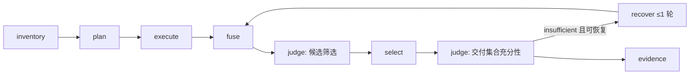

# WRR 7 重构设计：Jev 裁决的本机能力路由内核

日期：2026-10-19（rev 3：用户已批准 rev 2；吸收切片 1–4 审核裁决）。状态：已批准，实施中。
研究依据：[方向综合](../../research/2026-10-19-direction-synthesis.md)、[TypeSafe 官方 patterns/SDK](../../research/2026-10-19-typesafe-official-patterns.md) 及其引用的研究。
需求权威仍是 Obsidian L1《WRR-需求基准线》；第 2 节列出本次用户决策对 L1 的取代项，需同步回 L1。

## 1. 核心需求（用户 2026-10-19 原话 → 可证伪需求）

| ID | 用户原话 | 可证伪需求 |
|---|---|---|
| CR-1 | "Hermes、OMP、Pi、CC 都能对搜索进行有效的调用" | 四宿主各有一个薄适配；同一 query + 同一 inventory + 同一配置 + 同一 judge 回放，内核产出相同的 plan 与 evidence 合同（不要求联网结果相同）。 |
| CR-2 | "对搜索来源（API 式、Skill 式、CLI 式、MCP）进行有效模块化整合" | 来源用统一 `SourceDescriptor` 声明；新增来源只增 manifest + adapter 文件，不改内核；api/cli/mcp/skill/host 是 `transport` 字段，不是五套路由。 |
| CR-3 | "本机里面有什么，我就调用什么" | `inventory` 发现本机来源并分级（§4.1）；路由候选集只取 `routable` 来源；不要求用户预配 mode 表。 |
| CR-4 | "自动化的路由和验证，质量优先" | 选源、筛选、充分性由 Jev typed judgment 决定；每次响应带阶段质量状态（executed / relevance / sufficiency）；不足时内核最多补搜一轮，再不足如实返回 `insufficient`，不补造结果。 |
| CR-5 | "用 Jev 定一套规则，把路由整合起来，我们只负责接入" | 语义规则全部收敛为一个 rubric 模块（问题集 + 阈值 + policy 常量）+ 确定性前置门；代码里不再有关键词→mode 表；宿主适配不复制任何规则。 |
| CR-6 | "接入 OMP 时用 OMP 原生 /model 里的搜索源和 Jev 配置" | OMP 适配把 `modelRoles.web` + `fallbackChains.web` 作为一个 `host` 来源，把 `modelRoles.judge` 作为 judge 后端；不要求用户在 WRR 另配 key。 |
| CR-7 | "还有 TypeSafe 的" | 问题设计遵循 TypeSafe 官方 patterns（代码掌控流程、原子问题、同 state fan-out、confidence 门、JSON state/criteria）；直连时按官方 API 合同（`noul/choice/score`），不继承官方 SDK 默认重试。 |
| CR-8 | "Python 内核 + 一轮补搜" | 内核 Python ≥3.11；补搜固定 ≤1 轮，由确定性代码执行。 |
| CR-9 | "有 judge 即默认开" | 宿主 judge 或 WRR 自有 `TYPESAFE_API_KEY` 任一存在即启用 Jev；无 judge 时走确定性默认并在 evidence 标 `judge=none`。外发范围见 §4.5 隐私门。 |
| CR-10 | "通过隧道调用其他设备（pc、macmini、macbook）互通进行合并搜索" | 其他设备运行 `wrr serve`，本机把它暴露的来源当 `transport=remote` 来源纳入 inventory，与本地来源同场 fuse/judge；hop 上限 1，不级联；远端 local/authenticated 结果不送云端。 |
| CR-11 | "方便扩展、快速整合信息源和扩展 CLI" | 三档接入（§4.0）：输出 JSON 的 CLI / MCP / HTTP 只写一份 YAML，不写代码；非标准接口写一个 adapter 文件；两者都不改内核与宿主。 |

沿用的 L1 约束（不变）：Exa + DeepSeek 主力并行；学术精确书目边界；筛选保留原证据身份、不生成链接；私密/本地/登录态来源不送云端；热路径不做 live probe / 安装 / 重启 / 浏览器；MH-01~07、NR-01~08；非目标：报告生成、浏览器交互、通用编排。

## 2. 本次决策取代的 L1 / ADR 条目

| 被取代 | 新口径 | 原因 |
|---|---|---|
| L1 "8 mode 路由"、`MODE_DISPATCH/MODE_WEIGHTS` 为真值 | 删除 mode；Jev 输出 `evidence_shape` choice + per-source noul | CR-5 |
| L1 "Stage S/C、legacy 保护"、ADR 晋级证据/campaign/request admission ledger | 全部删除；新内核是唯一数据面；回归保护 = judge 回放契约测试 + 评估集 | 清洁切换 |
| ADR-S2 "Jev 源码默认关闭，只存在 key 不启用" | 有 judge 即默认开（CR-9）；外发内容限 query + 公开候选的 title/url/snippet；隐私门不变 | 用户 2026-10-19 决策；需在 L1 §云端筛选行登记 |
| L1 "classify_intent 测试 + mode dispatch 断言" | plan 合同测试（judge 回放）+ 评估集指标 | CR-5 |
| ADR-01 "router 只消费 EngineDescriptor" | 保留精神；descriptor 扩展为 `SourceDescriptor` | 兼容 |

保留的 ADR：R3（daemon vs one-shot + state cache）、R4（信任分级）、H1（health policy 裁决 routable，枚举不变）、H2（Agent-Reach 仅 provenance）、H3（browser 不进热路径）。

## 3. 目标 / 非目标 / 反目标

目标：CR-1~9。
非目标：研究报告、答案生成、新 query 生成（Jev 不生成文本）、浏览器交互、抓取正文的事实核验、自动安装/升级来源、把 TypeSafe 官方 `typesafe-ai` skill 注册为来源（它是开发指导）。
反目标：
- 任何宿主里出现第二份路由规则或 provider 表。
- 用一个总 confidence 掩盖"哪一阶段没过"。
- Jev 故障导致隐私/注入门 fail-open（只有相关性筛选允许 fail-open 保留原序）。
- 为凑 top-k 触发超过一轮补搜；把 `unjudged` 标成"已筛选"；把原始集合的充分性写成交付集合的充分性。

## 4. 内核架构（`wrr/core`）



Jev 调用预算：常规 3 次（plan 1 + 候选 1 + 交付充分性 1）；恢复路径合并后再做 1 次候选筛选（含 `raw_candidate_sufficiency`），**不再**重问交付充分性，总上限 4（`_MeteredJudge` 强制）。每次逻辑判断 = 单个 POST，无应用层重试。单次软预算按载荷大小 1.5–3 s（`rubric.judge_budget_s`：基础 1.5 s + 每 12k 字符 1 s，上限 3 s；实测 2k 字符 plan 批 0.5–1.0 s，1 万 token 候选批 1.0–1.7 s），受总 deadline 约束。

### 4.0 扩展三档（新来源接入成本）

| 档 | 适用 | 需要写什么 | 不需要 |
|---|---|---|---|
| A. 声明式 | 任何输出 JSON/NDJSON 的 CLI（`opencli xxx -f json`、`gh search`、`bili search --json`）、任何 MCP search tool、任何 HTTP JSON 搜索 API | 一份 `engine.yaml`：`transport`、命令/URL/MCP tool、字段映射（title/url/snippet/time 的 JSON 路径）、`upstream_family`、`privacy_class`、`profile`、凭据 env 名 | Python 代码、改路由、改宿主 |
| B. adapter | 需要分页/签名/HTML 解析/多步调用的来源 | `engine.yaml` + 一个实现 `SourceAdapter.search()` 的 Python 文件 | 改内核、改宿主 |
| C. remote | 另一台设备上已接好的任何来源 | 本机 `peers.yaml` 一行（URL + token） | 在本机重复配置该来源 |

路由对新来源零改动的原因：Jev 读 `profile` 决定 `fit`，RRF 读 `upstream_family` 去重，隐私门读 `privacy_class`；三者都来自 manifest。`wrr inventory --json` 与 `wrr doctor` 立即显示新来源的 provision/health。A 档沿用现有 `configured_sources.py` 的命令隔离与字段映射合同（host-driven，模型请求不能改命令）。

### 4.1 inventory（发现与分级）

- 输入：builtin/user/project manifests（沿用 `wrr/engines/loader.py` `engine.yaml` 与信任分级）、显式配置来源（`WRR_COMMUNITY_CONFIG` 式）、MCP 连接、宿主注入的 `HostCapabilities`。
- `SourceDescriptor`：
  - `id`、`kind ∈ {web, academic, code, community, local, host}`、`transport ∈ {api, cli, mcp, skill, host, remote}`；remote 来源另带 `device`（peer id）与远端原始 `transport`
  - `upstream_family`：有出处的目录（`exa`、`bing`、`google`、`openalex`…）。同 upstream 经 MCP/API/CLI 仍同 family。`host:web` 若宿主返回实际 provider 元数据则动态归族，否则 family=`host-web:opaque` 并在 `quality.independent_families` 中不计为独立来源。
  - `privacy_class ∈ {public, authenticated, local}`：决定结果能否进入 Jev state。
  - `capabilities`：search / fetch / similar、参数、返回是否含 answer/citations、freshness 能力。
  - `profile`：给 Jev 的 JSON 画像 `{covers, best_for, weak_for, freshness, languages, auth}`，不是一段散文。
  - 状态分两轴：`provision ∈ {installed, configured, authorized, disabled}` 与 `health ∈ {unknown, healthy, degraded, unhealthy, cooldown}`（沿用 v6.1 枚举）。
- **authorized** 定义：信任分级允许加载 ∧ 必需依赖/凭据已解析 ∧ 未被显式禁用 ∧（project 级来源需 `--trust-project`/allowlist）。**routable** = authorized ∧ health ∈ {healthy, degraded, unknown∧light-probe 通过} ∧ 非 cooldown。`unhealthy/cooldown` 不进候选；`degraded` 进候选但在 evidence 标注。
- 探测分级 static / light（热路径）/ live（仅 doctor 或 TTL 过期）；状态缓存 `~/.cache/wrr/state.json`。
- Skill 来源：只有带可执行入口（命令 + JSON 输出合同）的 skill 才进入候选；纯 `SKILL.md` 仅作 handoff 推荐（MH-04）。

### 4.2 plan（确定性门 + 检索前 1 次 Jev）

确定性门（0 次 Jev）：
1. 显式 `sources` 参数 → 跳过选源 judge 直接执行；候选筛选与交付充分性 judge **照常**（质量优先，2026-10-19 裁决）；不触发补搜。
2. 精确书目（`https://doi.org/...`、`doi:`、裸 DOI、`references:`、`citations:`，复用 `_academic_query` 解析）→ 仅 academic，全程 0 次 Jev。
3. 本地意图 → 仅 local 来源，禁止送云端。
4. 隐私门：query 命中敏感启发式 → `judge=skipped:sensitive_query`，走默认计划。
5. 预算：总 deadline、每来源 deadline、最大来源数（默认 4）、最大候选数（默认 20）。

检索前 Jev（1 次）。state 为命名 JSON：
```json
{"request": {"query": "...", "today": "2026-10-19", "constraints": {"site": null, "lang": null}},
 "sources": [{"id": "exa", "profile": {...}}, {"id": "openalex", "profile": {...}}]}
```
问题（同 state、互相独立）：
- `evidence_shape`: choice ∈ {fact_lookup, overview, recent_news, academic, code, community_opinion, local_knowledge}，criteria 用 JSON `{what, not_for}`。
- `freshness_required`: noul。
- `fit.<id>`: noul，每个 routable 来源一题，instructions 以路径引用 `sources[i]`，true/false 描述区分"能提供该 query 需要的证据"与"只是同主题"。fit 直接对 query 判断，不依赖 `evidence_shape` 的答案。

代码组合（policy，全部记录进 `plan.reasons`）：
- `fit ≥ 0.65` accept；`0.35–0.65` uncertain；`< 0.35` reject。先取 accept 按概率降序；不足最小来源数（默认 2）再补 uncertain。
- 主力 Exa + DeepSeek（若 routable）强制保留，理由标 `forced:primary`，不伪称 judge 选中。
- `evidence_shape` confidence 低于门限或 Jev 失败 → 默认计划（主力 + `host:web`），`plan.judge` 标 `degraded`/`none`。
- 截到最大来源数。

### 4.3 execute

并发执行，共享 deadline；每来源独立 timeout；取消链 AbortSignal → RPC cancel → Python task cancel → 子进程 SIGINT → KILL 宽限。输出 `SourceRun{source_id, status ∈ {ok, empty, timeout, auth_error, rate_limit, schema_error, error, cancelled}, elapsed_ms, results[]}`，部分失败保留。热路径禁止 live probe / 安装 / 重启 / 浏览器。用户取消返回 `cancelled`，不得转成任何 fail-open 成功。fuse 产出候选时 title ≤300、snippet ≤2000 字符，超限置 `clipped=True`。

### 4.4 fuse

RRF（k=60）+ `upstream_family` 去重：同规范化 URL 同 family 取最大贡献。输出带 `contributions[]` 的候选列表。

### 4.5 judge ①：候选筛选（1 次）

隐私门（先于一切）：只有 `privacy_class=public` 来源的结果进入 state；authenticated/local 结果直接保留并标 `unjudged:private`。命中敏感启发式或非公开 URL 的候选**逐条**排除出 state，保留在结果中标 `unjudged:sensitive`，其余照常判断（2026-10-19 裁决，取代整批跳过）；交付 judge 的 `scope` 记录排除数。已知误判：`_ENTROPY` 会把长 GitHub/slug 路径段判为敏感，校准待评估集决定，未放宽。
state：
```json
{"request": {"query": "...", "today": "..."},
 "candidates": [{"id": "c0", "title": "...", "url": "...", "snippet": "...", "clipped": false, "source_kind": "web"}]}
```
问题：
- `rel.<id>`: noul —— 片段提供回答所需证据（纠正错误前提也算有用）；"同主题但无助回答"为 false。
- `inj.<id>`: noul —— 含指令注入 / 试图改变系统行为。
- `answerable`: noul —— 候选集合中至少存在可用依据。
- `raw_candidate_sufficiency`: noul —— 原始候选集合整体足以回答（仅描述原始集合）。

代码规则：`inj ≥ 0.5` 丢弃；`0.3–0.5` 保留但标 `inj:suspect` 且不计入充分性；`rel ≥ 0.5` 保留，按 rel 降序、同分原序；溢出（>20）标 `unjudged:overflow` 保留原序。
失败语义：超时/HTTP/畸形 → 保留原序，`relevance=degraded`；隐私门与本地注入启发式不 fail-open。

### 4.6 select → judge ②：交付集合充分性（1 次）

select 产出交付集合（top-k，默认 8）。再问一次（新 state = request + 交付集合 + `scope` 说明哪些材料未评估/私密/被剔除）：
- `enough`: noul —— 交付集合足以回答。
- `next_action`: choice ∈ {accept, broaden_sources, need_fresher, insufficient}，读取 confidence。

代码规则：`enough ≥ 0.6` 且 `next_action=accept` → 结束；`next_action` confidence 低于门限 → 视为 `unknown`，不执行恢复，`sufficiency.enough` 照实返回。`scope` 中存在私密/未评估材料时，`sufficiency.scope=public_only`，不把它们计为已充分。

### 4.7 recover（≤1 轮，确定性）

触发：`enough < 0.6` ∧ `next_action ∈ {broaden_sources, need_fresher}` 且 confidence 达标 ∧ 剩余预算 ≥ 下限 ∧ 有可用的未尝试来源。**不触发**：候选 judge 有效且所有已判候选被 rel/inj 拒绝（`scope=all_rejected`，直接 `insufficient`，L1 "有效全拒绝不补搜"）；显式 `sources`；确定性门路径。
未尝试来源 = routable ∧ 有执行器（adapter/declarative/configured）∧ kind≠local（local gate 除外）∧ 选源阶段未被 `rejected`；按 fit 降序，`need_fresher` 优先 freshness 能力强者。合并后 fuse，对**新增候选**做 judge ①（含 `raw_candidate_sufficiency`），重新 select；不重问 judge ②。本轮有新的公开已判候选 → `sufficiency` 标 `after_recovery:raw_scope`；没有 → `enough=None`、`after_recovery:not_judged`，不沿用首轮值。不生成新 query；不重试失败来源。

**隐私默认**：缺 `source` 块的非 builtin 来源（user/project manifest、配置来源、MCP）`privacy_class=authenticated`——结果保留但不进 Jev state；只有显式声明才是 public。声明式 CLI 子进程只拿 manifest `shared_env_keys` 列出的 env；`{query}` 以 `-` 开头且前一 token 非 `--` 时拒绝执行。

### 4.8 evidence（统一输出合同）

```json
{
  "query": "...",
  "plan": {"evidence_shape": {"choice": "overview", "confidence": 0.81}, "sources": ["exa", "deepseek", "host:web"],
           "reasons": {"exa": "forced:primary", "host:web": "fit:0.72"}, "judge": "host|typesafe|none|degraded|skipped:<reason>"},
  "runs": [{"source_id": "exa", "status": "ok", "elapsed_ms": 812, "count": 8}],
  "results": [{"title": "...", "url": "...", "snippet": "...", "contributions": [{"source_id": "exa", "rank": 1}],
               "judgment": {"rel": 0.91, "inj": 0.02} , "flags": []}],
  "quality": {"executed": "ok|partial|failed|cancelled",
              "relevance": "judged|degraded|unjudged|skipped",
              "sufficiency": {"enough": 0.74, "next_action": "accept", "confidence": 0.7, "scope": "delivered|public_only|after_recovery:raw_scope"},
              "independent_families": 2, "recovered": false},
  "diagnostics": {"deadline_ms": 15000, "elapsed_ms": 4211, "judge": {"calls": 3, "posts": 3, "model": "jev-1.13.0", "usage": {"input_tokens": 3120, "output_tokens": 0}}}
}
```
不变量：`results[i].url` 永远来自某个 `SourceRun`；`quality` 三段独立降级；`judge.calls`（逻辑）与 `posts`（物理）分开。

### 4.9 remote peers（跨设备合并搜索）

- **服务端**：每台设备 `wrr serve --bind <tailscale-ip>:<port>`（HTTP/JSON，同一内核）。端点：`GET /v1/inventory`（该设备 routable 来源的 `SourceDescriptor`，含 `profile`、`privacy_class`、`upstream_family`，不含凭据）、`POST /v1/search`（`{query, sources[], deadline_ms, call_id, hop}` → 原始 `SourceRun[]`，**不做** judge/fuse）、`POST /v1/cancel`。
- **传输与认证**：优先 Tailscale 直连（ACL 限制端口），备选 `ssh -L` 隧道；每条 peer 配 bearer token（`~/.config/wrr/peers.yaml`：`id, url, token_env, enabled`），token 不进 manifest、不进 evidence。只监听 tailnet/loopback 地址，拒绝 0.0.0.0。
- **本机视角**：peer 的每个来源成为 `transport=remote` 的 `SourceDescriptor`（`id=macmini/opencli-xiaohongshu`）。inventory 启动时拉 `/v1/inventory` 并缓存（TTL，ADR-R3），拉取失败 → 该 peer 全部 `health=unhealthy`，不阻塞本地搜索。
- **路由**：remote 来源与本地来源同场参加 `fit` 判断与 RRF；`upstream_family` 跨设备去重（本机 Exa 与 macmini Exa 同 family，不重复计票；默认不同时选两处同 family 来源，除非一处不可用）。典型价值：macmini 上登录态的 opencli 社区源、PC 上的本地 Obsidian/QMD 库、不同 API 配额。
- **判断只在发起端做一次**：peer 只执行并返回原始结果；judge/fuse/select 在发起端。remote 来源的 `privacy_class` 原样继承——macmini 的 local/authenticated 结果在本机同样不进 Jev state。
- **防级联**：请求带 `call_id` 与 `hop`；`wrr serve` 收到 `hop≥1` 的请求只执行本机非 remote 来源。deadline 由发起端扣除往返余量后下发。
- **非目标**：不做分布式索引、不做 peer 之间的凭据共享、不自动发现 peer（必须显式配置）。

## 5. Judge 后端抽象与 rubric 模块

```
class Judge(Protocol):
    async def judge(self, state: JSON, questions: dict[str, Question]) -> JudgeResponse
# JudgeResponse{answers: dict[str, Answer], model: str|None, usage: Usage|None, backend: "host"|"typesafe", request_id: str|None}
```
- 解析顺序：`HostJudge`（宿主注入）→ `TypeSafeJudge`（`TYPESAFE_API_KEY`，`jev-latest`，可 pin）→ `NoJudge`。
- Question 类型内核统一用 `noul / choice / score`（与 TypeSafe wire 一致）；OMP eval/判断 bridge 侧 `bool↔noul` 由 OMP 适配器映射。
- `TypeSafeJudge` 用 httpx（沿用 `search_filter.py` 的 client 注入、`trust_env=False`、禁重定向、无重试、外层绝对 deadline）；官方 Python SDK 默认 10 s/2 retries/30 s budget 不符合热路径，列为未来可替换实现。
- 取消：Python 侧 task cancel 关闭请求；取消不产生任何"判断成功"记录。
- `wrr/core/rubric.py` 是唯一维护问题文案、criteria JSON、阈值（fit 0.65/0.35、rel 0.5、inj 0.5/0.3、enough 0.6、choice confidence 门）、来源数/候选数的位置；宿主不得复制。

## 6. 宿主适配（薄）

| 宿主 | 目标版本 | 形态 | 搜索能力注入 | judge 注入 | 要点 / 原生 seam 不成立时的替代 |
|---|---|---|---|---|---|
| OMP | 本机 18.12.x | extension（TS）+ 内核子进程 | 同名 `web_search` wrapper；`host:web` 经 `ctx.invokeTool` 调原生链 | `resolveJudge`（`@oh-my-pi/pi-coding-agent/judgment`，公开子路径导出，已在 18.12.0 实测） | stdio NDJSON RPC；token 不出宿主进程。替代：`resolveJudge` 不可 import → `host.judge=false`，Python 侧按 §5 顺序回退 `TypeSafeJudge`/`NoJudge`（不在扩展内直连 SDK）；`ctx.invokeTool` 不可用 → 不注入 `host:web` |
| Hermes | macmini 安装版（实施前核实） | `WebSearchProvider` backend plugin（Python，同进程） | 自身即 backend；Hermes 其他 backend 不作为来源 | `TypeSafeJudge` | 映射到 `{"success":true,"data":{"web":[...]}}`。替代：目标版本无 `register_web_search_provider` → 保留现有 `web_search` override 路径（已有 grant） |
| Pi | 当前 earendil-works/pi 发布版 | extension（TS）+ 内核子进程 | 来源全部来自 inventory | `modelRegistry.findOfType("classifier","typesafe","jev-latest")` + `classify()` | 同 OMP RPC。替代：无 classifier → `TypeSafeJudge` |
| Claude Code | 当前 CLI（MCP 路径） | MCP server（stdio，Python） | `WebSearch` 不作为来源 | `TypeSafeJudge` | 内核 deadline < MCP hard timeout；mod 路径后续 |
| CLI | — | `wrr search` | inventory | `TypeSafeJudge` | 评估与 doctor 入口 |
| 其他设备 | 同版本内核 | `wrr serve`（HTTP/JSON，Tailscale/ssh 隧道） | 暴露该设备 routable 来源 | 不做 judge | 见 §4.9；launchd/systemd 常驻由 builder 给模板 |

RPC 协议（OMP/Pi 共用）：内核 stdout NDJSON；`{"id","method","params"}` / `{"id","result"|"error"}`；方法 `judge`、`host_search`、`progress`、`cancel`；最终 `{"result": <evidence>}`。扩展对每个 request 透传 AbortSignal → `cancel`。
递归防护：`ctx.invokeTool` 直达同名原生内置工具、不重入 wrapper（18.12.0 实测，见 omp-seam-verification §2），因此不需要 callId/hop 字段；模型可见 schema 不含任何旁路参数。

## 7. 删除与保留清单

删除：`wrr/router.py` v5 路由与 modes、`config.py` `MODE_DISPATCH/MODE_WEIGHTS`、`selection_shadow.py`、Stage S/C、`evidence_gate.py` 的 campaign/admission ledger、campaign sampler、`wrr_similar` 独立工具（similar 归 Exa capability）、`hermes-overlay/` 与 mode 绑定的文案、`docs/architecture/*.html` 快照。
保留并移植：全部 adapter（exa、deepseek、brave、tavily、searxng、academic、github、community/opencli、local_*、mcp_source、configured_sources）、`_fusion.py`、`search_filter.py` 的隐私启发式与 passage 投影、`loader.py` manifest 与信任分级、`runtime/state` 缓存与 breaker、`doctor` 探测（重接 inventory）、`fetch_transport` 与 `fetch` 工具（语义不改）。
文档：README 重写；7.0.0 release notes；`docs/unified-capability-maintenance-proposal.md` 标注被取代段落；L1 登记 §2 取代项。

## 8. 评估与验收

- **契约测试**：固定 judge 回放下 plan/fuse/judge/select/recover 输出确定；四宿主适配各一条 search 往返（真实注册、mock 来源）；取消路径返回 `cancelled`。
- **评估集**：≥60 条真实 query（中英各半，含 DOI/本地/敏感负例），来源：本机 omp 会话归档 + Hermes 日志抽样，经用户同意并脱敏；标注由 Claude 初标、用户抽检 ≥20%。指标与初始通过线（可调）：选源召回 ≥0.8、筛选误杀 ≤10%、`enough` Brier ≤0.2、p95 相对直接 Exa 增量 ≤1.5 s、常规路径 judge posts ≤3。
- **烟测**：OMP 新会话 `web_search` → evidence，`plan.judge=host`；Hermes backend 实跑；CLI 实跑。
- **验收口径**：CR-1 同输入同 plan；CR-3 新增 manifest 不改内核即被发现；CR-4 无 judge 时 `judge=none`，有 judge 时 posts ≤4；CR-9 默认启用在 doctor 可见；CR-10 本机 + macmini 两端 `wrr serve` 互通，macmini 的 opencli 来源出现在本机 inventory 并参与一次真实合并搜索，`runs[]` 可辨设备；CR-11 用一份 YAML 接入一个输出 JSON 的 CLI（如 `bili search`），不改任何 `.py`。

## 9. 阶段切片（供 writing-plans 展开）

1. `wrr/core` 合同、数据类型、`rubric.py`、Judge 抽象、回放测试。
2. inventory：移植 loader/health/state，产出 `SourceDescriptor`；`wrr inventory --json`。
   - 含 A 档声明式 manifest 的 CLI/MCP/HTTP 通用执行器（移植 `configured_sources.py`）。
3. plan/execute/fuse/judge/select/recover + adapter 移植；`wrr search` 切到新内核。
4. 技术假设核验（§11）→ OMP 扩展重写（RPC、HostJudge/HostSearch、同名 wrapper）+ 烟测。
5. `wrr serve` + remote transport + `peers.yaml`；本机 ↔ macmini 真实合并搜索烟测。
6. Hermes backend plugin + Pi extension + Claude Code MCP。
7. 删除清单、文档、评估集跑分、7.0.0 发布记录。

## 10. 留给 builder 的决定

NDJSON RPC 字段细节；`profile` 初版文案（评估集校准）；MCP server 用官方 Python SDK 还是最小 stdio；`host:web` provider 元数据的解析位置；阈值全部进 `rubric.py` 并在评估后调整。

## 11. 首批需核验的技术假设（第 4 步前）

- 本机 OMP 18.12.0 单文件发行版能否 import `judgment` subpath 并调用 `resolveJudge`；`ctx.invokeTool` 委托原生 `web_search` 的取消与 usage 归属；原生结果是否带 provider 元数据。
- macmini Hermes 版本是否有 `register_web_search_provider`。
- Exa / `host:web` 链 / MCP / CLI 来源的 upstream 重叠（family 目录初版）。

## 12. builder-check 裁决记录

| 问题 | 裁决 | 性质 |
|---|---|---|
| CR-9 默认开是否满足 L1"显式授权" | 用户 2026-10-19 决策即授权；外发限 query + 公开候选 title/url/snippet；私密/本地/登录态不外发；需同步 L1 | 用户决策 + 我的边界 |
| authorized / routable 定义 | §4.1 两轴定义 | 我的决定 |
| 宿主目标版本与替代路径 | §6 表 | 我的决定 |
| 评估集所有者与通过线 | §8：本机归档 + Hermes 日志，用户同意后抽样；Claude 初标、用户抽检；初始通过线列出 | 我的决定，需用户同意抽样来源 |
| `host:web` 的 upstream_family | §4.1：有 provider 元数据则动态归族，否则 opaque 且不计独立来源 | 我的决定 |
